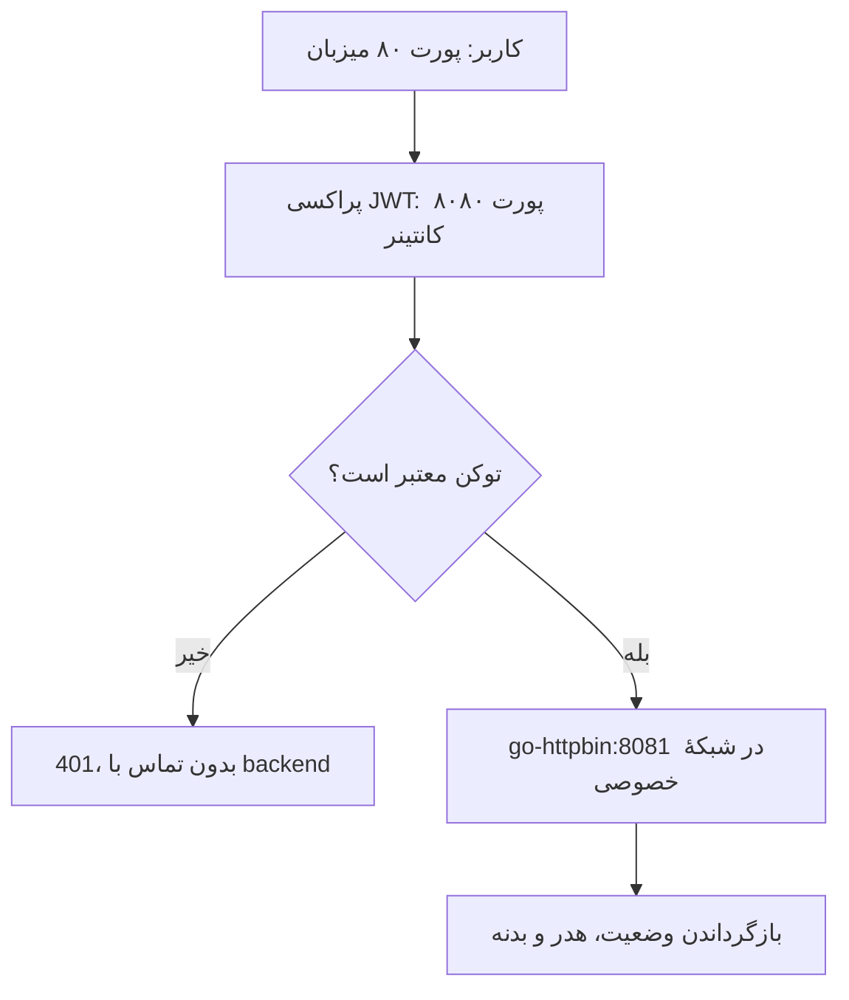

<div dir="rtl" align="right" lang="fa">

# تمرین عملی سری اول HTTP: پراکسی معکوس با JWT

این پروژه سه بخش صورت تمرین <code dir="ltr">http-hands-on.pdf</code> را پوشش می‌دهد: محدودکردن سرویس به شبکهٔ داخلی، توضیح TLS Termination و پیاده‌سازی پراکسی احراز هویت جلوی نسخهٔ Go سرویس httpbin.

پراکسی با Python نوشته شده است؛ زبان سرویس backend همان Go است و از ایمیج خواسته‌شدهٔ <code dir="ltr">ghcr.io/mccutchen/go-httpbin:2.20.0</code> استفاده می‌کند. طبق صورت تمرین، نوشتن پراکسی به یک زبان خاص محدود نشده است.

## ۱. چگونه یک سرویس را فقط روی شبکهٔ داخلی اجرا کنیم؟

اصل کار این است که **آدرس گوش‌دادن سرویس، مسیریابی و قواعد دسترسی شبکه** همگی درست تنظیم شوند. صرفاً انتخاب پورت ۸۰۸۱ یا نوشتن یک IP خصوصی، سرویس را خودکار امن نمی‌کند.

### حالت اول: پراکسی و سرویس روی یک ماشین

سرویس قدیمی را به <code dir="ltr">127.0.0.1:8081</code> متصل می‌کنیم. در این حالت، برنامه‌های همان ماشین می‌توانند به آن وصل شوند، اما دستگاه‌های دیگر مستقیماً به این آدرس دسترسی ندارند. پراکسی روی آدرس قابل‌دسترسی ماشین، مثلاً پورت ۸۰، گوش می‌دهد و به loopback متصل می‌شود.

در این سناریو نباید سرویس قدیمی را روی <code dir="ltr">0.0.0.0</code> منتشر کرد، چون این نشانی به معنی گوش‌دادن روی تمام واسط‌های IPv4 همان فضای شبکه است.

### حالت دوم: دو ماشین در شبکهٔ داخلی

سرویس روی IP داخلی خودش گوش می‌دهد. فایروال فقط اتصال از IP پراکسی به پورت سرویس را می‌پذیرد و اتصال مستقیم سایر مبداها را رد می‌کند. روی روتر هم نباید برای backend یک port forwarding عمومی تعریف شود. قواعد IPv6 نیز باید بررسی شوند.

مثلاً اگر IP داخلی پراکسی <code dir="ltr">10.0.0.10</code> و backend برابر <code dir="ltr">10.0.0.20</code> باشد، فقط ترافیک <code dir="ltr">10.0.0.10 → 10.0.0.20:8081</code> مجاز می‌شود. استفاده از IP خصوصی بدون فایروال، دسترسی دیگر اعضای شبکهٔ داخلی را محدود نمی‌کند.

### روش استفاده‌شده در این پروژه

در <code dir="ltr">compose.yaml</code>، شبکهٔ <code dir="ltr">private</code> با <code dir="ltr">internal: true</code> تعریف شده است. سرویس <code dir="ltr">legacy</code> فقط عضو این شبکه است و هیچ <code dir="ltr">ports</code> منتشرشده‌ای روی میزبان ندارد. فقط پراکسی به هر دو شبکهٔ <code dir="ltr">public</code> و <code dir="ltr">private</code> وصل می‌شود.

سرویس Go داخل کانتینر روی <code dir="ltr">0.0.0.0:8081</code> گوش می‌دهد تا پراکسی در کانتینر دیگر به آن دسترسی داشته باشد. این <code dir="ltr">0.0.0.0</code> متعلق به فضای شبکهٔ همان کانتینر است، نه انتشار خودکار روی میزبان. اگر داخل کانتینر backend از <code dir="ltr">127.0.0.1</code> استفاده کنیم، پراکسیِ کانتینر دیگر نمی‌تواند وصل شود.

فقط نگاشت <code dir="ltr">80:8080</code> برای پراکسی تعریف شده است: درخواست به پورت ۸۰ میزبان، وارد پورت ۸۰۸۰ کانتینر پراکسی می‌شود. این سرویس از اینترنت پورت منتشرشده‌ای ندارد. مدیر میزبان Docker همچنان به منابع تحت مدیریت خودش دسترسی دارد؛ این طراحی برای مقابله با مدیر میزبان نیست.

ویژگی <code dir="ltr">expose: 8081</code> مستند می‌کند که سرویس در شبکهٔ کانتینری از این پورت استفاده می‌کند؛ **ویژگی expose به‌تنهایی فایروال نیست**. نبودن <code dir="ltr">ports</code> برای backend و جداسازی شبکه، بخش اصلی این پیاده‌سازی‌اند. هر کانتینر دیگری که مدیر به شبکهٔ خصوصی اضافه کند نیز ممکن است به backend دسترسی داشته باشد.

## ۲. فلسفهٔ TLS Termination چیست؟

در TLS Termination، ارتباط رمز‌شدهٔ کاربر روی پراکسی پایان می‌یابد. پراکسی گواهی و کلید TLS را دارد، داده را از کانال امن دریافت می‌کند و پس از بررسی درخواست، آن را به سرویس داخلی می‌فرستد.

برای مثال، مرورگر با <code dir="ltr">https://example.com</code> به پراکسی وصل می‌شود و پراکسی با <code dir="ltr">http://legacy:8081</code> با سرویس قدیمی صحبت می‌کند. خود سرویس قدیمی لازم نیست پیاده‌سازی TLS یا مدیریت گواهی را بلد باشد.

مزایای این روش:

- اطلاعات حساس مثل توکن در مسیر عمومی با HTTPS محافظت می‌شود.
- مدیریت گواهی و تمدید آن در ورودی متمرکز است.
- کنترل JWT، محدودیت حجم و سیاست‌های دسترسی را می‌توان جلوی سرویس قدیمی اعمال کرد.
- بدون تغییر کد سرویس legacy، یک ورودی امن‌تر برای آن فراهم می‌شود.

**استفاده از TLS جای احراز هویت را نمی‌گیرد.** این پروتکل از کانال ارتباط محافظت می‌کند و JWT هویت درخواست را مشخص می‌کند. فقط استفاده از JWT روی HTTP آشکار، توکن را از شنود محافظت نمی‌کند.

اگر مسیر بین پراکسی و backend قابل‌اعتماد نباشد، باید آن بخش نیز با TLS، mTLS یا یک شبکهٔ امن مناسب محافظت شود. داخلی‌بودن IP به معنی غیرقابل‌شنودبودن نیست.

پیکربندی اصلی این پروژه برای تطبیق با پورت ۸۰ صورت تمرین و آزمایش در محیط کنترل‌شده، HTTP است. در <code dir="ltr">compose.https.yaml</code> نمونهٔ جداگانهٔ TLS Termination با Caddy وجود دارد: Caddy روی پورت‌های ۸۰/۴۴۳ قرار می‌گیرد و به پراکسی JWT متصل می‌شود. پورت ۸۰ در آن حالت برای هدایت HTTP به HTTPS است و سرویس legacy همچنان در شبکهٔ خصوصی می‌ماند.

## ۳. پیاده‌سازی JWT Authentication Proxy

### مسیر درخواست

<div dir="ltr" align="left">



</div>

### اجزای پروژه

| فایل | کاربرد |
|---|---|
| <code dir="ltr">proxy/app.py</code> | بررسی JWT و ارسال درخواست به backend ثابت |
| <code dir="ltr">compose.yaml</code> | اجرای اصلی روی پورت ۸۰ و شبکهٔ خصوصی |
| <code dir="ltr">Dockerfile</code> | ساخت کانتینر پراکسی با کاربر غیر root |
| <code dir="ltr">tools/generate_secret.py</code> | تولید کلید تصادفی محلی |
| <code dir="ltr">tools/mint_token.py</code> | ابزار مدیریتی ساخت توکن آزمایشی |
| <code dir="ltr">tools/smoke_test.py</code> | آزمایش زنده پس از اجرای Docker |
| <code dir="ltr">tests/test_proxy.py</code> | آزمون‌های خودکار احراز هویت و انتقال پیام |
| <code dir="ltr">compose.https.yaml</code> و <code dir="ltr">deploy/Caddyfile</code> | نمونهٔ اختیاری TLS Termination |

### قواعد اعتبارسنجی JWT

توکن باید در هدر <code dir="ltr">Authorization: Bearer &lt;TOKEN&gt;</code> قرار بگیرد. پراکسی فقط <code dir="ltr">HS256</code> را می‌پذیرد و امضا را با PyJWT بررسی می‌کند. الگوریتم از ورودی کاربر انتخاب نمی‌شود.

وجود <code dir="ltr">exp</code>، <code dir="ltr">iat</code>، <code dir="ltr">iss</code>، <code dir="ltr">aud</code> و <code dir="ltr">sub</code> الزامی است. زمان انقضا و صدور، و <code dir="ltr">nbf</code> در صورت وجود، بررسی می‌شوند. صادرکننده باید <code dir="ltr">http-lab</code> و مخاطب باید <code dir="ltr">legacy-api</code> باشد. موضوع توکن یک شناسهٔ ASCII با طول ۱ تا ۱۲۸ نویسه است. به این ترتیب می‌توان آن را بدون خطر تزریق خط جدید در هدر هویت استفاده کرد.

توکن ناقص، منقضی، با امضای نادرست یا ادعاهای نامعتبر با ۴۰۱ رد می‌شود. در این حالت هیچ درخواستی به legacy ارسال نمی‌شود. به تمام مسیرهای عادی HTTP، از جمله <code dir="ltr">/</code>، کنترل JWT اعمال می‌شود؛ مسیر عمومیِ صدور توکن وجود ندارد.

### رفتار ارسال درخواست

روش، مسیر، query و بدنه به backend ثابت ارسال می‌شوند. پراکسی redirect سرور را خودش دنبال نمی‌کند؛ همان وضعیت و Location را به کلاینت می‌دهد. پاسخ دودویی و فشرده بدون decode کردن دوباره عبور می‌کند و هدرهای تکراری مانند Set-Cookie حفظ می‌شوند.

هدرهای hop-by-hop و هدرهای معرفی‌شده توسط Connection حذف می‌شوند. هدر Authorization به backend فرستاده نمی‌شود تا توکن در پاسخ‌های بازتاب‌دهندهٔ httpbin افشا نشود. مقدارهای ارسالی کاربر برای هدر هویت و هدرهای forwarding حذف می‌شوند و پراکسی <code dir="ltr">X-Authenticated-User</code> را از <code dir="ltr">sub</code> معتبر می‌سازد. این نمونه IP واقعی کاربر را از زنجیرهٔ پراکسی‌ها استنتاج نمی‌کند.

برای جلوگیری از ذخیرهٔ مشترک دادهٔ احراز هویت‌شده، پاسخ‌های عبوری با <code dir="ltr">Cache-Control: private, no-store</code> برمی‌گردند. این تغییر هدر آگاهانه است؛ این پروژه کش شفاف نیست.

بدنهٔ درخواست حداکثر ۱ MiB است و پیش از ارسال در حافظه خوانده می‌شود. پاسخ به‌صورت جریانی ارسال می‌شود. برای خطای اتصال به backend، پاسخ ۵۰۲ و برای timeout پیش از شروع پاسخ، ۵۰۴ برمی‌گردد. بعد از شروع پاسخ، خطای جریان نمی‌تواند وضعیت HTTP تازه‌ای جایگزین کند و اتصال باید خاتمه یابد. پشتیبانی از WebSocket و تونل CONNECT در محدودهٔ این نمونه نیست.

## اجرای سریع در Windows / PowerShell

پیش‌نیازها: Docker Desktop با Linux containers و Docker Compose، و Python 3.10 یا جدیدتر برای ساخت کلید. موتور Docker باید فعال باشد. همهٔ دستورها را داخل پوشهٔ پروژه اجرا کنید.

### گام ۱: تولید کلید و اجرای سرویس‌ها

<div dir="ltr" align="left">

```powershell
python tools/generate_secret.py
docker compose up --build -d
docker compose ps
```

</div>

در اولین اجرا، دانلود ایمیج‌ها و وابستگی‌ها به اینترنت نیاز دارد. فایل <code dir="ltr">secrets/jwt_secret.txt</code> تولید می‌شود و به کانتینر mount می‌شود؛ کلید در Docker image کپی نمی‌شود. مقدار آن را منتشر نکنید. در Linux پوشهٔ میزبان با مجوز ۷۰۰ و فایل با مجوز ۶۴۴ ساخته می‌شود تا کاربر غیر root داخل کانتینر بتواند فایلِ mount‌شده را بخواند؛ دسترسی میزبان با مجوز پوشه محدود می‌شود. در Windows مجوزهای واقعی تابع ACL و Docker Desktop هستند.

اگر پورت ۸۰ اشغال است، ابتدا سرویس اشغال‌کننده را شناسایی و مسئله را رفع کنید. برای تحویل مطابق صورت سؤال، پورت میزبان ۸۰ باقی می‌ماند. صرفاً برای آزمایش محلی می‌توان موقتاً نگاشت را به <code dir="ltr">8080:8080</code> تغییر داد و URLها را نیز عوض کرد.

### گام ۲: درخواست بدون توکن

<div dir="ltr" align="left">

```powershell
curl.exe -i http://localhost/get
```

</div>

انتظار: <code dir="ltr">401 Unauthorized</code>. بازکردن URL در مرورگر بدون فرستادن توکن نیز ۴۰۱ می‌دهد؛ این رفتار درست است.

### گام ۳: ساخت توکن معتبر

<div dir="ltr" align="left">

```powershell
$TOKEN = (docker compose run --rm --no-deps proxy python tools/mint_token.py --subject student --minutes 15).Trim()
curl.exe -i -H "Authorization: Bearer $TOKEN" "http://localhost/get?course=ie&item=1&item=2"
```

</div>

انتظار: پاسخ ۲۰۰ و JSON سرویس Go. در بخش <code dir="ltr">args</code> پارامترهای query دیده می‌شوند و در بخش <code dir="ltr">headers</code> باید هدر <code dir="ltr">X-Authenticated-User</code> با مقدار <code dir="ltr">student</code> وجود داشته باشد. هدر Authorization عمداً به backend نرسیده است.

فایل <code dir="ltr">mint_token.py</code> فقط ابزار مدیریتیِ آزمایش است. کسی که به کلید امضا یا اجرای مدیریتی کانتینر دسترسی دارد می‌تواند توکن بسازد؛ آن را endpoint عمومیِ ورود در نظر نگیرید. الگوریتم HS256 کلید مشترک دارد و کلید باید فقط در اختیار صادرکننده و اعتبارسنج مجاز باشد.

### گام ۴: بررسی POST و توکن خراب

<div dir="ltr" align="left">

```powershell
curl.exe -i -X POST -H "Authorization: Bearer $TOKEN" -H "Content-Type: text/plain" --data "hello from student" http://localhost/post
curl.exe -i -H "Authorization: Bearer invalid-token" http://localhost/get
```

</div>

انتظار: برای POST پاسخ ۲۰۰ و بازتاب متن ورودی؛ برای توکن خراب پاسخ ۴۰۱.

### گام ۵: آزمایش خودکار روی سرویس واقعی

<div dir="ltr" align="left">

```powershell
docker compose exec proxy python tools/smoke_test.py --url http://127.0.0.1:8080
```

</div>

این دستور هفت بررسی زنده را روی پراکسی و go-httpbin اجرا می‌کند: توکن غایب/خراب/منقضی، GET با query و هدر هویت، POST با JSON، حفظ وضعیت ۴۱۸ و حفظ redirect. موفقیت آن باید در سیستم اجراکننده بررسی شود.

آزمایش زنده از داخل کانتینر، پورت داخلی ۸۰۸۰ پراکسی را می‌زند. برای اطمینان از انتشار درست پورت ۸۰ میزبان، دستور curl گام‌های قبل نیز لازم است.

### گام ۶: بررسی منتشرنشدن backend

<div dir="ltr" align="left">

```powershell
docker compose port legacy 8081
curl.exe --connect-timeout 3 http://localhost:8081/get
docker compose logs --tail 30 proxy legacy
```

</div>

دستور اول نباید نگاشت منتشرشده‌ای برای legacy نشان بدهد و درخواست مستقیم به localhost:8081 نباید به backend این پروژه برسد. اگر برنامهٔ دیگری قبلاً روی ۸۰۸۱ میزبان فعال بوده باشد، پاسخ آن متعلق به این پروژه نیست. <code dir="ltr">docker compose ps</code> و فایل Compose را هم بررسی کنید؛ فقط پراکسی باید پورت منتشرشده داشته باشد.

### توقف

<div dir="ltr" align="left">

```powershell
docker compose down
```

</div>

### معادل ساخت توکن در Linux / Bash

<div dir="ltr" align="left">

```bash
TOKEN=$(docker compose run --rm --no-deps proxy python tools/mint_token.py --subject student --minutes 15)
curl -i -H "Authorization: Bearer $TOKEN" http://localhost/get
```

</div>

## اجرای نمونهٔ اختیاری HTTPS

پیکربندی HTTPS جایگزین پیکربندی اصلی است؛ هم‌زمان هر دو را بالا نیاورید.

<div dir="ltr" align="left">

```powershell
docker compose down
docker compose -f compose.https.yaml up --build -d
$TOKEN = (docker compose -f compose.https.yaml run --rm --no-deps proxy python tools/mint_token.py).Trim()
curl.exe -i http://localhost/get
curl.exe -k -i -H "Authorization: Bearer $TOKEN" https://localhost/get
```

</div>

پراکسی Caddy برای localhost گواهی محلی می‌سازد. گزینهٔ <code dir="ltr">-k</code> فقط برای همین آزمایش محلی است؛ در محیط واقعی باید زنجیرهٔ گواهی معتبر باشد. درخواست HTTP باید به HTTPS هدایت شود؛ درخواست HTTPS بدون توکن باید ۴۰۱ و با توکن معتبر باید ۲۰۰ بگیرد. در این پیکربندی، پورت پراکسی JWT نیز روی میزبان منتشر نشده است.

برای دامنهٔ واقعی، <code dir="ltr">localhost</code> را در Caddyfile با دامنه جایگزین و <code dir="ltr">tls internal</code> را حذف کنید. تنظیمات DNS، دسترسی پورت‌ها و امکان صدور گواهی باید فراهم باشند. اگر شبکهٔ داخلی قابل‌اعتماد نیست، ارتباط داخلی نیز باید رمز شود.

<div dir="ltr" align="left">

```powershell
docker compose -f compose.https.yaml down
```

</div>

## آزمون‌های خودکار بدون Docker

<div dir="ltr" align="left">

```powershell
python -m pip install -r requirements.txt
python -m unittest discover -s tests -v
```

</div>

این آزمون‌ها از transport آزمایشی HTTPX استفاده می‌کنند؛ به اینترنت، Docker و backend واقعی نیاز ندارند. آن‌ها توکن‌های نامعتبر، روش و بدنه، مسیر و query، هدر جعلی، gzip، پاسخ دودویی، Set-Cookie تکراری، redirect، محدودیت حجم و خطاهای upstream را بررسی می‌کنند.

## وضعیت اعتبارسنجی هنگام آماده‌سازی

- ۱۶ آزمون خودکار این بسته اجرا شده و پاس شده‌اند؛ در بعضی آزمون‌ها چندین ورودی با subtest بررسی می‌شوند.
- فایل‌های Compose از نظر ساختار YAML و نبودن پورت منتشرشده برای legacy بررسی می‌شوند؛ این بررسی جای <code dir="ltr">docker compose config</code> یا اجرای واقعی را نمی‌گیرد.
- ابزار Docker در محیط آماده‌سازی نصب نبود؛ بنابراین ساخت Docker image، pull ایمیج go-httpbin، شبکهٔ کانتینری، اجرای هفت بررسی زنده و نمونهٔ Caddy در این محیط اجرا نشده‌اند.
- دستورهای بخش اجرا برای انجام و بررسی این مرحله‌ها در سیستم دارای Docker آماده شده‌اند. خروجی نمونهٔ زنده به‌عنوان خروجی واقعاً ثبت‌شده ادعا نمی‌شود.
 HTTPS مهم‌اند. تغییر کلید، همهٔ توکن‌های قبلی را باطل می‌کند.
